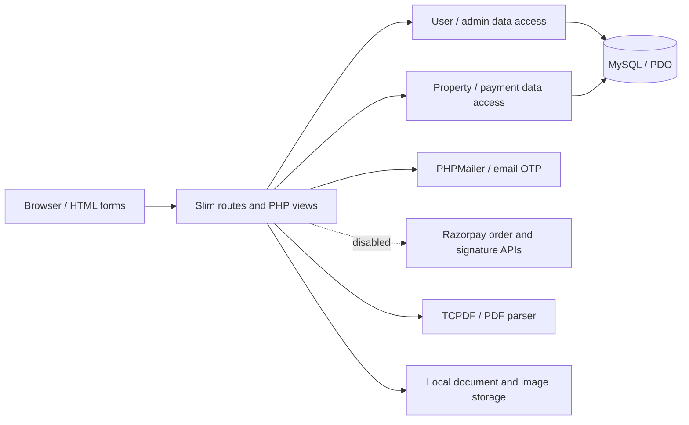

# Property Marketplace

A PHP/Slim property marketplace prototype with MySQL persistence, account workflows, listing filters, disabled Razorpay payment routes and experimental PDF contracts.

## Why this project exists

Property transactions connect several backend concerns: account state, searchable listings, ownership, payment records and generated documents. This project brings those workflows into a server-rendered application with separate user and admin interfaces.

**Status:** prototype requiring security and setup remediation. The repository name is `E-Commerce`, but the application handles property listings. External identity verification is stubbed. Real payment routes are disabled. The presence of security-related code does not establish a secure deployment.

## Architecture



[index.php](index.php) configures routing and rendering. [User routes](routes/user.php) and [property routes](routes/property.php) coordinate workflows; [data-access classes](api/classes) use PDO. Most routes return rendered HTML or form redirects, with some JSON responses.

## Engineering Highlights

- Property listing creation, editing, filtering and ownership-related views.
- Registration/login with password hashing, PHP sessions, email OTP and password-reset flows.
- Separate admin pages for user status and property administration.
- Legacy Razorpay order and signature-verification code is retained for review, but both payment endpoints are disabled.
- PDF contract generation and an experimental document-integrity check.

These are implemented code paths, not claims of independently validated security, live payment operation or production scale.

## Tech Stack

| Area | Technologies |
| --- | --- |
| Application | PHP, Slim 4, PHP-DI, PHP views |
| Persistence | MySQL, PDO |
| Browser | HTML/CSS, JavaScript, jQuery, Materialize |
| Integration | PHPMailer, Razorpay PHP SDK |
| Documents | TCPDF, Smalot PDF parser |

## How It Works

1. Account routes create users, compare password hashes, maintain session state and support email verification/reset workflows.
2. Listings store price, location, availability, property type, amenities and ownership information. Browser filters request matching properties from the backend.
3. Both payment routes return 503 before the payment handlers execute. The legacy code lacks atomic transactions, verified order/property binding, idempotency and reconciliation; it must not be enabled for real payments.
4. Eligible participants can request a generated PDF contract. A separate checker hashes extracted text and compares it with an encrypted embedded value. This is an experimental integrity mechanism, not a standard digital-signature implementation.
5. The document-upload/KYC screens collect data, but external verification calls are disabled and success is forced. Do not treat this as verified identity or upload real identity documents.

The schema includes users, sessions, email OTPs, admin accounts, properties, locations, amenities and payments. It mixes InnoDB and MyISAM tables and does not define foreign keys; relational integrity and payment consistency need further work.

## Setup

For a safe visual preview, open [`demo/index.html`](demo/index.html) locally in a browser. It uses only fictional listings and local assets; it is a standalone interface, not the PHP app, and does not create accounts, connect to services or process payments. Filter the listings using the type selector.

For source review in an isolated checkout:

```bash
git clone https://github.com/yashwant938/E-Commerce.git
cd E-Commerce
composer install
```

Composer is required; no PHP version or dependency lockfile is pinned. The existing schema uses MySQL 8 collation syntax. Apache with URL rewriting is expected.

Before starting an HTTP server:

1. Replace credential literals in configuration/mail code with local environment configuration. Rotate any still-active exposed credentials. Do not reuse values from the repository.
2. Prepare a schema-only database and synthetic demo fixtures. **Do not import the bundled account/payment records as demo identities or publish the SQL dump.**
3. Keep all network integrations disabled. The protected-route authorization gate checks the current database account before dispatching; the narrow regression checks below do not establish that the rest of the application is secure.
4. Make the front controller's `/FCS` base path and `.htaccess`'s `/fcs` rewrite path consistent. Configure local PDO access and writable upload directories using synthetic files only.
5. Keep outbound email, payment and identity-service calls disabled for local review. A full application sandbox still needs explicit mail capture, payment test adapters and clearly marked identity stubs; the standalone preview does not exercise those integrations.

Do not expose this checkout publicly or submit real account, identity or payment data. There is no verified end-to-end setup or database/payment integration test suite yet.

## Checks

Run `php tests/security_test.php` with PHP CLI. It exercises deny-before-dispatch for invalid, inactive, unverified and missing users, database errors, and parameterized listing-filter construction including injection-shaped input. The tests do not connect to MySQL or verify payment behavior. PHP syntax checks can be run with `php -l` on changed PHP files. The standalone demo requires only a browser.

## Example

A **target local test scenario after the setup gaps are addressed** is: synthetic seller creates a listing → synthetic buyer filters by location/budget → a payment test adapter returns a successful result → backend records the result → both parties inspect a generated contract.

The source contains the corresponding listing, payment and contract code paths. This walkthrough is not an instruction to make a real payment, and it has not been validated as a complete sandbox demo.

## Engineering Challenges

- **Authorization:** protected handlers now run only after the current account is checked; other routes, admin flows, sessions and object-level access still need an independent review.
- **Database safety:** the main listing search binds filter values and rejects malformed IDs. Its amenity matching is still substring-based, and the rest of the application needs a comprehensive query audit and MySQL integration tests.
- **Transaction consistency:** payment and property updates in the legacy code are separate, and the payment table uses MyISAM. Payment endpoints are disabled until order binding, transactions, retries and concurrency are implemented and tested.
- **Trust boundaries:** KYC is bypassed; upload handling, session settings, state-changing GET routes and the generic API helper's disabled TLS verification need remediation.
- **Reproducibility:** committed configuration/data, ignored dependency locks and a template README have made the project harder to run and assess safely.

## Future Improvements

- Move secrets to environment configuration; replace stored records with schema migrations and synthetic fixtures.
- Audit all remaining queries and authorization paths; validate uploads and keep documents outside public web paths.
- Model payments as explicit state transitions with order/property binding, idempotency, transactional storage and failure-path tests.
- Replace placeholder identity checks and custom document integrity with suitable, reviewed mechanisms when the requirements are defined.
- Pin runtime/dependencies and add a full-app isolated sandbox, mail/payment test adapters, CI and setup verification before considering deployment or performance testing.
